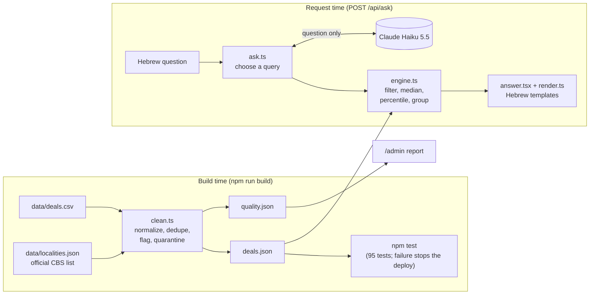
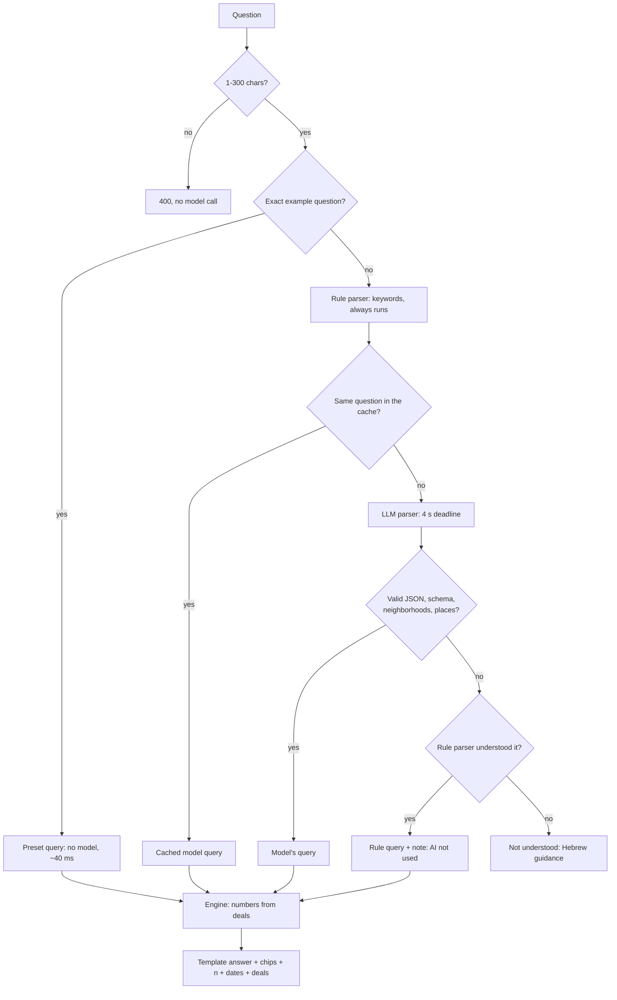

# Madlan deals: ask about Israeli property deals in Hebrew

A Hebrew, right-to-left web app for **home buyers**. You ask a free-text question such as "כמה עולה דירת 4 חדרים בכפר סבא?" or "3.2 מיליון ל-4 חדרים בכפר סבא, זה סביר?", and get an answer computed only from real closed deals, always with the number of deals and the date range behind it.

**Live:** `https://madlan-tech-challenge.vercel.app`

**The core idea:** the LLM only translates the question into a structured query. It never sees the deal data and never writes a number or a sentence of the answer. Plain code computes every fact, and Hebrew templates word it.

| Challenge constraint                          | How it is met                                                                                                            | Section                                                          |
| --------------------------------------------- | ------------------------------------------------------------------------------------------------------------------------ | ---------------------------------------------------------------- |
| 1. Live and public                            | Next.js on Vercel                                                                                                        | [Deployment](#12-deployment)                                     |
| 2. Hebrew, RTL                                | `lang="he" dir="rtl"`, Hebrew UI, templates and parsing                                                                  | [What it does](#1-what-it-does)                                  |
| 3. The LLM does real work                     | It turns free Hebrew (slang, nicknames, relative dates, comparisons) into a validated query; 31/31 on the evaluation set | [The LLM line](#3-what-goes-to-the-model-and-what-code-computes) |
| 4. 10,000 requests a day, known cost          | ~$21/month for the LLM, $0 hosting; presets, prompt cache, query cache                                                   | [Cost](#5-cost-and-scale-at-10000-requests-a-day)                |
| 5. Never states what the data doesn't support | No model-written facts; minimum sample size; visible basis for every number                                              | [Grounding](#3-what-goes-to-the-model-and-what-code-computes)    |
| 6. Survives a slow, wrong or missing model    | 4 s deadline, strict validation, a keyword parser with the same schema as fallback                                       | [Failures](#4-failure-handling)                                  |

---

## 1. What it does

**Persona: a buyer**, asking "is this price reasonable?" or "what can I get?". That is the highest-stakes use of this data, so not overclaiming matters most.

| Question type | Example                                  | Answer                                                         |
| ------------- | ---------------------------------------- | -------------------------------------------------------------- |
| Search        | דירות 4 חדרים ברעננה עם חניה עד 3 מיליון | Matching deals, newest first, with the total count             |
| Typical price | כמה עולה דירת 4 חדרים בכפר סבא?          | Median, middle half (25th–75th percentile), n, dates           |
| Price check   | 3.2 מיליון ל-4 חדרים בכפר סבא, זה סביר?  | Where the price falls among comparable deals (percentile). Without a city: answered as a budget question, by city |
| Budget        | יש לי 2 מיליון, מה אפשר לקנות?           | Deals at 80–100% of the budget, by city: count, rooms, size    |
| Ranking       | איפה הכי זול לקנות 3 חדרים?              | Cities or neighborhoods by median price per m² (5+ deals each) |
| Comparison    | רמת גן מול גבעתיים                       | Two sides, each with its own median and n; never widened       |
| Trend         | איך השתנו המחירים בחולון מאז 2022?       | Median price per m² per year; thin and partial years marked    |

**Declined, with a Hebrew explanation:** forecasts, investment advice, and anything not in the data (rent, asking prices, schools, transport). A real place with no deals gets "אין במאגר עסקאות ב…", never a country-wide answer.

The start page has six example questions, one per main type. `/admin` is a password-protected, read-only data-quality report.

---

## 2. Architecture



- **No database.** The cleaned deals (518 rows) are bundled into the server at build time and loaded once per server instance. The engine answers in about 0.02 ms.
- **Stack:** Next.js 16 (App Router, Cache Components), React 19, TypeScript, zod, `@anthropic-ai/sdk`, Node 24. Runtime dependencies: only `next`, `react`, `react-dom`, `zod`, `@anthropic-ai/sdk`.

### How a question is answered



If the model and the rule parser disagree on a city the rules saw explicitly, the model's reading is used and the user sees a note with the other reading.

---

## 3. What goes to the model, and what code computes

| Step                                                                                                                      | Done by                                                             | Why it sits there                                                            |
| ------------------------------------------------------------------------------------------------------------------------- | ------------------------------------------------------------------- | ---------------------------------------------------------------------------- |
| Understanding natural-language Hebrew (synonyms, word order, short forms like ת"א, relative dates, two-sided comparisons) | **LLM**                                                             | The one job keywords do badly. This is the "real work"                       |
| Same, when the model is slow, down or wrong                                                                               | Rule parser (code)                                                  | Same `Query` schema, so the rest of the system doesn't care which parser ran |
| Checking the model's output                                                                                               | Code: zod schema, official locality list, neighborhoods in the data | The model's reply is untrusted input                                         |
| Cleaning the data                                                                                                         | Code, at build time                                                 | Must be reproducible and logged row by row                                   |
| Every number: counts, medians, percentiles, groups                                                                        | Code (engine)                                                       | A model can invent or miscompute numbers                                     |
| Every sentence of the answer                                                                                              | Hebrew templates                                                    | So nothing is phrased beyond what was computed                               |

**What the model receives:** a cached system prompt (about 4,000 tokens) with the query types and rules, the covered cities, property types, conditions, every "neighborhood — city" pair, the latest data month (for "last year"), and the JSON Schema of `Query`. The user message is **only the question**. No deal rows are ever sent.

**What it returns:** one JSON `Query`, for example:

```json
{
  "type": "stat",
  "metric": "price",
  "filters": { "cities": ["כפר סבא"], "rooms": { "min": 4, "max": 4 } }
}
```

---

## 4. Failure handling

Every model failure is a result, not an exception, and every one ends with an answer from the rule parser (or an honest "not understood").

| What goes wrong                                                          | What the system does                                               | What the user sees                                         |
| ------------------------------------------------------------------------ | ------------------------------------------------------------------ | ---------------------------------------------------------- |
| No API key                                                               | The SDK fails on the request; logged; rule parser                  | A normal answer + "parsed by keywords" note                |
| Model slow (over 4 s, including retries)                                 | Aborted (`timeout`); rule parser                                   | Answer within ~4 s + note                                  |
| Rate limit (429) or server error (5xx)                                   | SDK retries twice inside the 4 s; then `api-<status>`; rule parser | Answer + note                                              |
| Connection dropped                                                       | `connection`; rule parser                                          | Answer + note                                              |
| Reply isn't JSON                                                         | `invalid-json`; rule parser                                        | Answer + note                                              |
| Reply doesn't match the schema (unknown type, made-up city, wrong field) | `schema-mismatch`; rule parser                                     | Answer + note                                              |
| Reply names a neighborhood that doesn't exist                            | `unknown-neighborhood`; rule parser                                | Answer + note                                              |
| Reply names a real place with no deals                                   | Converted to "no data for X"                                       | "אין במאגר עסקאות ב…"                                      |
| Refusal or truncated reply (`max_tokens`)                                | `stop-refusal` / `stop-max_tokens`; rule parser                    | Answer + note                                              |
| Model and rule parser disagree on the city                               | Model's reading used, the other offered                            | Answer (model) + "the keyword parser understood …" warning |
| Neither parser understands the question                                  | No query                                                           | Hebrew guidance: name a city, rooms, price or type         |
| Anthropic monthly spend limit reached                                    | API errors → rule parser for every question                        | Answers continue, all keyword-parsed                       |
| Invalid request (empty, over 300 chars)                                  | 400, no model call                                                 | "The question wasn't accepted"                             |
| Server unreachable                                                       | Browser catches the error                                          | "No connection to the server, try again"                   |

---

## 5. Cost and scale at 10,000 requests a day

**Assumption:** 10,000 `/api/ask` requests a day (~300,000 a month), all treated as typed questions (example clicks are free, so this is the upper bound).

| Item                       | Basis                                                        | Per month |
| -------------------------- | ------------------------------------------------------------ | --------- |
| **LLM (Claude Haiku 5.5)** | ~$0.00007 per question with the prompt cache warm (measured) | **~$21**  |

**Per-question token economics** (Haiku 5.5 per million tokens: input $0.10, cache write $0.125, cache read $0.01, output $0.50):

```
cost ≈ system prompt (~4,000) × $0.01/M  +  question (~26) × $0.10/M  +  output (~53) × $0.50/M  ≈ $0.00007
```

At ~7 requests a minute, every request refreshes the 5-minute prompt cache, so only quiet periods pay a cache write. Cost grows with the number of distinct neighborhoods (they are in the prompt), not with the number of deals.

**What is cached and precomputed:**

| What                             | How                                                                                                                        | Saves                                            |
| -------------------------------- | -------------------------------------------------------------------------------------------------------------------------- | ------------------------------------------------ |
| The system prompt                | Anthropic prompt caching (`cache_control`)                                                                                 | ~90% of input cost                               |
| The six example questions        | Queries written in advance (`lib/examples.ts`); a test keeps them equal to the rule parser's reading                       | The whole model call: ~40 ms instead of ~1 s, $0 |
| Repeated typed questions         | In-memory LRU, 1,000 entries per server instance: question → validated model query. Only undisputed model results are kept | The model call on a repeat                       |
| Cleaned data, vocabulary, prompt | Built once per build / per server instance                                                                                 | All per-request preparation                      |
| **Not cached: answers**          | The engine takes 0.02 ms, costs money, and cached answers would go stale after new data                                    | —                                                |

**Limits currently in place:**

- Question length: 1–300 characters (checked before any model call).
- Model call: 4 s total deadline, 2 retries for transient errors only, `max_tokens` 1024, thinking off.
- Query cache: 1,000 entries per instance.
- **Anthropic Console monthly spend limit:** the hard ceiling on cost. Set it to about 2× the expected cost (~$50). When reached, the app keeps answering through the rule parser.

**Not built yet (planned, see [Next steps](#14-next-steps-for-a-real-madlan-feature)):** per-IP rate limit (429 with `Retry-After`), a daily cap on model calls (then rules only), and a circuit breaker.

### What would change at 10× (100,000 requests a day)

| Area                  | At 10×                                                  | Change                                                                                                                                                                                    |
| --------------------- | ------------------------------------------------------- | ----------------------------------------------------------------------------------------------------------------------------------------------------------------------------------------- |
| LLM cost              | ~$210/month (cache warm)                                | Still small. Shrink the prompt: move the neighborhood list out of it and check neighborhoods in code, as cities already are                                                               |
| Abuse and peaks       | A flood costs real money                                | Per-IP rate limit, daily model-call cap, circuit breaker, as counters in **Redis** shared by every instance                                                                               |
| Anthropic rate limits | Peaks may exceed the account's requests-per-minute      | Raise the account tier; excess requests already fall back to rules                                                                                                                        |
| Hosting               | ~3M function calls/month exceeds Hobby                  | Paid plan                                                                                                                                                                                 |
| Popular questions     | Many repeats of the same phrasings                      | Grow the preset list from logged questions: free, instant, tested                                                                                                                         |
| Data volume           | Engine: 1.7 ms at 100× deals, 19 ms at 1000× (measured) | Deals in **Postgres** instead of memory: indexed SQL queries and data managed without a redeploy (memory still answers in 1.7 ms at 100×, so this is about managing data more than speed) |

---

## 6. Model choice

- **Claude Haiku 5.5** (`claude-haiku-5-5`): the cheapest current Claude model. Parsing needs no reasoning, so thinking is off and effort is low. Measured: 31/31 correct on the Hebrew evaluation set, median 1.0 s, max 2.3 s.
- **Overridable per deploy** with the `LLM_MODEL` environment variable, no code change.
- **Plain JSON validated by zod, not the API's structured outputs:** structured outputs rejected our schema (8 query types × ~15 optional filters) as "Schema is too complex" after ~40 s. The schema is in the cached prompt instead.
- **Rejected: free tiers of open models.** Their rate limits don't cover 10,000 requests a day, so at peak most answers would come from the fallback; their Hebrew quality is unmeasured; and the paid cost is small.

---

## 7. Data quality

The CSV is real-world shaped and unclean. Cleaning is a **deterministic build step** (`scripts/clean.ts` → `lib/clean.ts`): the same CSV always gives the same output, no LLM involved. **Every issue ends in one of three outcomes, always recorded:**

- **Fixed:** the value is normalized and the change is logged (row, field, before, after, rule).
- **Flagged:** the deal is kept, but something in it is marked. Depending on the problem, one of two things happens:
  - **One field is untrusted:** that field is treated as unknown, and the deal still counts. Example: "new from contractor" in a building sold 30 years after construction → condition unknown.
  - **The whole price is suspicious:** the deal is left out of all statistics until someone reviews it, but still appears in search with a badge. Example: a price per m² 2.5× or more away from its city's median.
- **Quarantined:** the row is left out of search and statistics, and kept in the report with its reason. |

`/admin` shows all of it: quarantined rows, deals pending review, every flag by reason, possible duplicates under different IDs, every automatic fix (before → after), and the thresholds.

---

## 8. Configuration

**Environment variables** (Vercel → Settings → Environment Variables, or `.env.local`):

| Variable              | Required     | Purpose                          | If missing                           |
| --------------------- | ------------ | -------------------------------- | ------------------------------------ |
| `ANTHROPIC_API_KEY`   | For the LLM  | Question parsing                 | Every question uses the rule parser  |
| `ADMIN_PASSWORD_HASH` | For `/admin` | never the plain password         | Admin login disabled, with a message |
| `LLM_MODEL`           | No           | Another Claude model for parsing | `claude-haiku-5-5`                   |

**Constants in code:**

| Setting               | Value    | File                                       | Effect                                                      |
| --------------------- | -------- | ------------------------------------------ | ----------------------------------------------------------- |
| `MIN_N`               | 4        | `lib/engine.ts`                            | Minimum deals for any statistic; also when widening stops   |
| `MAX_DEALS`           | 50       | `lib/engine.ts`                            | Deals returned per answer (n always reports the full count) |
| `MAX_QUESTION`        | 300      | `lib/ask.ts`, `app/page.tsx`               | Longest accepted question                                   |
| `CACHE_MAX`           | 1,000    | `lib/ask.ts`                               | Query cache entries per server instance                     |
| `DEADLINE_MS`         | 4,000    | `lib/parse-llm.ts`                         | Total time for the model call, including retries            |
| `max_tokens`, retries | 1,024, 2 | `lib/parse-llm.ts`, `app/api/ask/route.ts` | Reply length cap; transient-error retries                   |
| `DEALS_PAGE`          | 10       | `app/answer.tsx`                           | Deals shown before "show more"                              |

## **Data and vocabulary files:** `data/localities.json` (official localities; refresh with `npm run fetch-localities`)

## 9. Project structure

```
data/
  deals.csv              raw input (committed)
  localities.json        official Israeli localities, CBS snapshot (committed)
  deals.json             cleaned deals (generated at build, git-ignored)
  quality.json           data-quality report (generated at build, git-ignored)
scripts/
  clean.ts               CSV → deals.json + quality.json (runs before dev and build)
  fetch-localities.ts    refreshes data/localities.json from data.gov.il (by hand, ~yearly)
  hash-password.ts       prints ADMIN_PASSWORD_HASH for a password
lib/                     all logic: plain TypeScript, no framework code, fully unit-tested
  clean.ts               CSV parser, normalization, dedupe, outliers, contradictions, report, THRESHOLDS
  aliases.ts             city aliases (from localities.json + nicknames), property types, conditions, sources
  schema.ts              zod Query schema: the contract between parsers and engine
  parse-llm.ts           LLM parser: system prompt, call, deadline, validation, failure codes
  parse-rules.ts         keyword parser (the fallback) and the vocabulary built from the data
  ask.ts                 request orchestration: validation, presets, cache, parser choice, cross-check
  engine.ts              answers a Query from the deals: filters, medians, percentiles, widening
  render.ts              Hebrew wording: chips, verdicts, dates, decline messages, flag labels
  examples.ts            the six start-page questions with their precomputed queries
  admin-auth.ts          scrypt password check and HMAC-signed session cookie
  questions.ts           shared Hebrew test questions (rule-parser tests + LLM evaluation)
  *.test.ts              95 tests (node:test)
app/
  layout.tsx             <html lang="he" dir="rtl">, Heebo font
  page.tsx               the chat page: examples, conversation, input
  answer.tsx             answer view per question type, chips, deal list
  globals.css            all styles: CSS variables, dark mode, phone layout
  api/ask/route.ts       POST /api/ask: loads data once, calls lib/ask.ts
  admin/                 read-only data-quality report, login page, login/logout actions
README.md, DECISIONS.md, PLAN.md, AI-LOG.md   docs
AGENTS.md, CLAUDE.md     working rules for AI assistants on this repo
eslint.config.mjs        ESLint (Next.js + TypeScript rules)
.env.example             the environment variables
```

---

## 10. Running locally

**Requirements:** Node.js **24.x** (pinned in `package.json`; needed to run `.ts` scripts directly), npm.

```bash
npm install
cp .env.example .env.local      # fill in ANTHROPIC_API_KEY; for /admin, ADMIN_PASSWORD_HASH (below)
npm run dev                     # cleans the data, then serves http://localhost:3000
```

| Command                    | What it does                                                 |
| -------------------------- | ------------------------------------------------------------ |
| `npm run dev`              | Clean the data, start the dev server                         |
| `npm test`                 | 95 unit tests, ~1 s, no secrets needed                       |
| `npm run lint`             | ESLint: Next.js, React Hooks and TypeScript rules            |
| `npm run build`            | Clean the data, **run all tests**, then build for production |
| `npm run start`            | Serve the production build                                   |
| `npm run clean-data`       | Only regenerate `deals.json` and `quality.json`              |
| `npm run hash-password`    | Asks for a password, prints the `ADMIN_PASSWORD_HASH=…` line |
| `npm run fetch-localities` | Refresh the official localities list from data.gov.il        |

Notes: without `ANTHROPIC_API_KEY` the app still works, using the rule parser only. Don't run `npm run build` while `npm run start` is serving from the same folder: the build replaces `.next` under the running server.

---

## 11. Testing

95 unit tests (`node:test`, `lib/*.test.ts`) covering cleaning, parsers, engine, wording and admin auth; the LLM parser is tested against a fake model.

**Tests run on every build**, so a failing test stops a deploy and the live version stays up. A new CSV therefore needs `lib/data.test.ts` updated before it can deploy.

---

## 12. Deployment

Hosted on **Vercel** (Hobby plan), deployed from GitHub. Every push to `main` deploys automatically; a failed build or failing test never replaces the live site.

**Before going public:**

1. **Anthropic Console → Limits:** set a monthly spend limit (~$5). This is the cost ceiling.
2. Choose a strong admin password (16+ characters) and run `npm run hash-password`.

**First deploy:**

1. Push the repository to GitHub.
2. [vercel.com](https://vercel.com) → **Add New… → Project** → **Import** the repository (not "Clone"). Framework: Next.js, auto-detected; keep the default build command (`npm run build`).
3. **Environment Variables:** `ANTHROPIC_API_KEY` and `ADMIN_PASSWORD_HASH` (the whole `<salt>:<hash>` value), marked **Sensitive**, for Production. Optionally `LLM_MODEL`.
4. **Deploy** (~1–2 minutes). Check: the start page loads, an example answers instantly, a typed question answers in about a second, `/admin` asks for the password.

**Afterwards:**

- **Changed an environment variable:** Deployments → latest → **Redeploy**.
- **Rollback:** Deployments → an older deployment → **Promote to Production**.
- **New data:** replace `data/deals.csv`, check `/admin` locally, update `lib/data.test.ts`, push.
- **Stop spending:** remove `ANTHROPIC_API_KEY` and redeploy; the app keeps working on the rule parser.

Requirements: Node 24 (pinned in `package.json`, Vercel reads it), no database, no other services.

---

## 13. Known limitations

- **No rate limit, daily cap or circuit breaker yet.** The Anthropic spend limit is the only cost guard against a flood, and a model outage makes each question wait up to 4 s before the fallback.
- **The query cache is per server instance** and emptied on restart or deploy, so repeats only hit on a warm instance.
- **No way to recover bad data from the app.** A flagged or quarantined deal stays that way: `/admin` only shows it, and there is no "approve" or "restore". Bringing a deal back means fixing `data/deals.csv` or a rule in code (a threshold, a city nickname) and redeploying. This is what moving the deals to Postgres solves: approving or restoring a deal becomes a change in the database, not a redeploy (see [Next steps](#14-next-steps-for-a-real-madlan-feature)).
- The UI has no automated browser tests; it was checked by hand.

---

## 14. Next steps for a real Madlan feature

**Rebuild first: replace the CSV and the in-memory deals with Postgres.** Everything in the answers rests on the data. Today it is a CSV, cleaned at build time and loaded into each server's memory, so any change to the data means editing a file and redeploying. In a real feature, **Postgres becomes the place where deals live and are managed**:

**Then, in order:**

1. **Production guards in Redis:** per-IP rate limit (429 with `Retry-After`), a daily model-call cap that falls back to rules, and a circuit breaker. All three are small keys with an expiry, read on every request and shared by all instances. Only at a major scale-up (well beyond 10×), also move the question → query cache from per-instance memory to Redis, when a shared cache starts to pay for itself.
2. **Better comparables:** match by size, property type and building age, not only city and rooms.
3. **Deal highlights computed in code:** e.g. "18% below the median for similar apartments", parking + elevator, new building. Grounded, testable and free. LLM wording only on top of those facts, if it measurably helps.
4. **Admin:** company SSO instead of a shared password; login-attempt limits.
5. **UI:** automated browser tests; show the actual size range for small groups.
