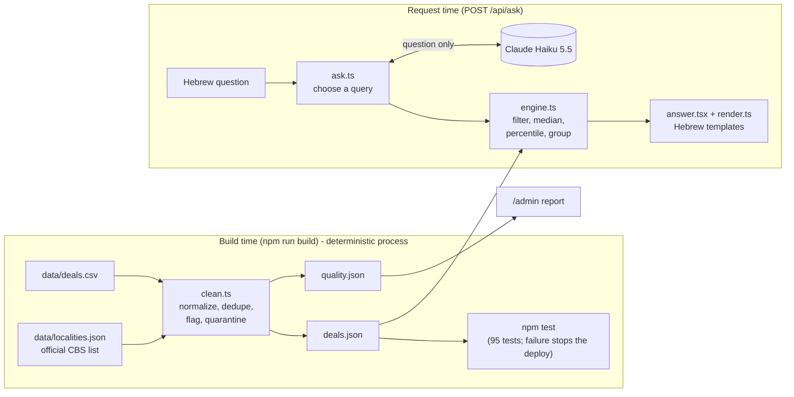
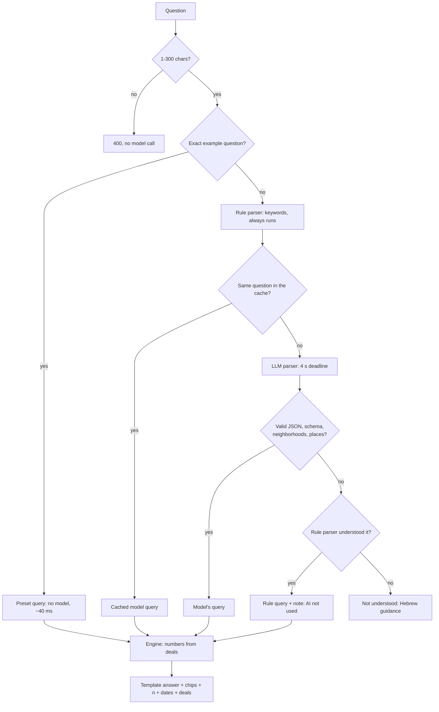

## 1. Demo

**What and why:**

- **The exercise:** build a system that takes a CSV of deals, normalizes and validates it, and lets a user ask questions in free-form language and get quick answers.
- **The result:** a Hebrew, right-to-left app. The user asks a question in his own words and gets an answer computed only from real closed deals.
- **Persona:** a potential real-estate buyer. Someone decides on millions based on the answer, so mistakes do the most damage there.
- **Can fir also for** sellers and real-estate agents (first two questions).

**Demo order:**

1. "כמה עולה דירת 4 חדרים בכפר סבא?": an example question, shows the median - not effected by outliars.
2. "3.2 מיליון ל-4 חדרים בכפר סבא, זה סביר?": the price's percentile among comparable deals.
3. "יש לי 3 מיליון, מה אפשר לקנות?": a budget question. Deals priced at 80–100% of the budget, grouped by city, with count, rooms and size.
4. "איפה הכי זול לקנות 3 חדרים?": a ranking question. Takes the 3-room deals, groups them by city, and ranks the cities by median price per m², cheapest first.
5. "רמת גן מול גבעתיים": a compare question. Two sides, each with its own median price per m², n and date range.
6. "איך השתנו המחירים בחולון מאז 2022?": a trend question. Holon deals from 2022 on, grouped by year, with the median price per m² for each year.
7. A question typed in free wording (e.g. ת"א, "בשנה האחרונה"): this one goes through the model.
8. "כמה יעלו המחירים בשנה הבאה?": declined, with the reason in Hebrew.
9. "דירות באילת": "אין במאגר עסקאות באילת", not a country-wide answer.
10. `/admin`, briefly: quarantine, outliers, fixes.
11. General rule for all answers: no median is calculated from fewer than 4 deals (`MIN_N`); the deals themselves are shown instead - not enough data. one unusual sale moves the result a lot.

---

## 2. Architecture (15 min)

> **Key sentence:** the model only translates a question into JSON. It never gets deal data and never writes a number or a sentence of the answer.

### System overview

### How a question is answered

### The model / code line

- **Model** (`lib/parse-llm.ts`): gets a system prompt with the query types, rules, covered cities, neighborhoods, property types, the latest data month (to resolve "last year") and the JSON Schema of `Query`. The user message is only the question.
- **Contract:** (`lib/schema.ts`) Is the only interface a parsed question is allowed to have. Both parsers (the LLM and the keyword rules) must produce an object that passes Query, and the engine in `lib/engine.ts` only reads that object. Zod checks the shape; it does not look at deals or compute a price. Question type: search, stat, priceCheck, budget, ranking, compare, trend, plus unsupported.
- **Code** (`lib/engine.ts`): filtering, medians, percentiles, grouping, widening. Every number shown comes from here.
- **Wording** (`lib/render.ts`): Hebrew templates.
- **Why the line is there:** free Hebrew (slang, short forms, relative dates, comparisons) is what keywords do badly and an LLM does well. Numbers are the reverse: a model can invent or miscompute them, code can't.

### Failures, and what the user sees

- The keyword parser (`lib/parse-rules.ts`) runs on every question and returns the same `Query` schema, so a fallback is always ready.
- One 4-second total deadline, including up to 2 SDK retries.
- Every model failure is a coded result, not an exception, and ends with an answer from the rule parser or an honest "not understood".
- Not the API's structured outputs ("Schema is too complex"); zod validates the reply.

| What goes wrong                                                          | What the system does                                       | What the user sees                                      |
| ------------------------------------------------------------------------ | ---------------------------------------------------------- | ------------------------------------------------------- |
| No API key                                                               | The request fails; rule parser                             | A normal answer + "parsed by keywords" note             |
| Model slow (over 4 s, including retries)                                 | Aborted (`timeout`); rule parser                           | Answer within ~4 s + note                               |
| Rate limit (429) or server error (5xx)                                   | 2 retries inside the 4 s, then `api-<status>`; rule parser | Answer + note                                           |
| Connection dropped                                                       | `connection`; rule parser                                  | Answer + note                                           |
| Reply isn't JSON                                                         | `invalid-json`; rule parser                                | Answer + note                                           |
| Reply doesn't match the schema (unknown type, made-up city, wrong field) | `schema-mismatch`; rule parser                             | Answer + note                                           |
| Reply names a neighborhood that doesn't exist                            | `unknown-neighborhood`; rule parser                        | Answer + note                                           |
| Reply names a real place with no deals                                   | Turned into "no data for X"                                | "אין במאגר עסקאות ב…"                                   |
| Refusal or cut-off reply                                                 | `stop-refusal` / `stop-max_tokens`; rule parser            | Answer + note                                           |
| Model and rule parser disagree on the city                               | Model's reading used, the other one offered                | Answer + "the keyword parser understood …" warning      |
| Neither parser understands                                               | No query                                                   | Hebrew hint: name a city, rooms, price or property type |
| Anthropic monthly spend limit reached                                    | API errors → rule parser for every question                | Answers continue, all keyword-parsed                    |
| Empty question or over 300 characters                                    | 400, no model call                                         | "The question wasn't accepted"                          |
| Server unreachable                                                       | The browser catches the error                              | "No connection to the server, try again"                |

### Cost at 10,000 requests a day

- Claude Haiku 5.5, thinking off, effort low; swappable via `LLM_MODEL`.
- **Caching and precomputation:**
  - Prompt caching on the system prompt (almost all the tokens); ~7 requests/min keeps it warm.
  - The six example questions have precomputed queries (no model call). Only the query is stored, so it stays correct when the data changes.
  - Query cache (`lib/ask.ts`): in-memory LRU, 1,000 entries, question → query. Only model readings the rule parser didn't dispute are cached.
  - Answers are not cached: the engine is fast and cached answers go stale.
  - Cleaned data is built once at build time; vocabulary and prompt once per server instance.
- **Numbers:** ~$0.00007 per question, ~$21/month. Per question, cache warm (Haiku 5.5 prices per million tokens):

| Part                               | Tokens | × Price   | Cost           |
| ---------------------------------- | ------ | --------- | -------------- |
| System prompt, read from the cache | 4,111  | $0.01 / M | $0.0000411     |
| The question (uncached, Hebrew)    | ~26    | $0.10 / M | $0.0000026     |
| The model's reply (the JSON query) | ~53    | $0.50 / M | $0.0000265     |
| **Total**                          |        |           | **≈ $0.00007** |

× 300,000 questions a month ≈ $21. Token counts come from Anthropic's tokenizer, so Hebrew is included: it takes ~1.7× more tokens per character than English. Without the prompt cache, writing the prompt every time costs ~$0.00054 per question, ~$160/month.

- **At 10×:** shrink the prompt (check neighborhoods in code), Redis rate limit / daily cap / circuit breaker, grow presets from repeated questions, move the cache to Redis only if repeats prove common.
- **High load or an attack (future improvement):**
  - **Per-IP rate limiter:** detects one client sending too many requests (an attack or a bot) and answers it with 429 + `Retry-After`, so it can't use up the model quota everyone shares.
  - **Circuit breaker:** after repeated 429s - "Too Many Requests." from the model, skip it for a short time (e.g. 30 s) and answer straight from the rule parser. That breaks the cycle of retries adding load, and answers stay fast during the spike.

### Not inventing facts, and showing what is grounded

- Closed schema: city must be from csv; other fields are closed lists; an unknown neighborhood is a failure.
- **Widening:** when a question matches fewer than 4 usable deals (`MIN_N`), the engine relaxes the room count by ±0.5 and tries again (`lib/engine.ts`, lines 60–77). It always tells the user it did.
- No statistic below `MIN_N = 4`: if widening is not possible - deals are shown without a median.
- Median, not average; outliers pending review are excluded and counted.
- An unknown value never matches a filter (unknown parking ≠ "with parking").
- **The user sees:** "how I understood the question" chips, n and date range next to every number, a note when the range was widened, the excluded count, the deals themselves, and which parser ran.

### Rebuild first

**Postgres instead of the CSV and in-memory data.** This will allow a real world system that can be updated with new deals, allow admins to manage quarantined items and make other types of changes, etc. In addition - it will support much larger sizes of data (number of deals) and it will greatly reduce memory foorprint - which can be a problem with Vercel.

### Working with Claude Code: where I corrected it

- **City list.** Claude Code suggested a hand-written list of cities to validate against during the build, but it wasn't complete: it was taken from the CSV itself. That made me realize the system must support future CSVs with other towns, so I added all of Israel's localities from the official government (CBS) list, with Hebrew and English names, and asked Claude to use it. The list hardly changes, so it is committed as a file.
- **Slow or failing model.** Claude Code's plan was to go straight to the keyword parser when the model fails or is slow. I asked for retries instead, within the same 4-second total deadline (up to 2 SDK retries).
- **Price conflicts.** Claude Code handled conflicts between different sources (using hierarchy), but didn't ask about conflicts within the same source. I added that case: the deal is kept, both prices are shown with a badge, and it is left out of price statistics.
- **Questions about the database.** I dropped question type 8 from Claude's proposal (how many deals do you have). They would expose the dataset's size and coverage I don't want users asking questions about the database itself, only about deals.

---

## 3. "Teach it": Claude is not an oracle (10 min)

**Topic:** how to build a project reliably with an AI coding assistant. The assistant writes code fast; your job is to build the checks that catch it when it's wrong. I give real cases that i had in this project

1. **Don't trust its claims: add tests.**
   - Mechanism: 95+ unit tests with real Hebrew questions against the real model.
2. **Make tests the gate, not its word.**
   - "It works" from the assistant means nothing until the tests say so.
   - Mechanism: `prebuild` runs the tests, and a failing test stops the deploy, so the live site stays up.
3. **Write decisions down: it forgets.**
   - Mechanism: `DECISIONS.md` (what and why) plus a one-line comment in the code where a rule lives.
   - Case: widening once turned a Neve Tzedek question into a Tel Aviv median.
4. **Check its assumptions against reality: run it yourself and read the code.**
   - Case: the city list was taken from the sample CSV, so a new CSV with another town would break.
5. **Push back on over-engineering.**
   - Case: it proposed Upstash Redis for a query cache with a hit rate nobody had measured: a new service and paid calls on every request. An in-memory LRU of 1,000 entries was enough.
   - Need to ask - "what does it actually give us? is it really necessary"
   - Also used the ponytail plugin, which asks the LLM to think like a senior developer - and try to simplify code and architecture as much as possible. This saves complexity and tokens.
6. **Its output is untrusted input:** validate it (zod, with data lists).
7. **Sometimes less can be more**
   - Case: it suggested having the LLM write the answers. The added value is small (nicer wording) and the costs are real: extra latency, a chance of wrong numbers or mistakes, and one more failure point.
   - Decision: the LLM only parses the question; code computes every number and Hebrew templates word it.

**Exercise:** "Claude says the cache is working. How do you check?" Expected: don't ask it; look at the response (`llm.cached`) and measure.
